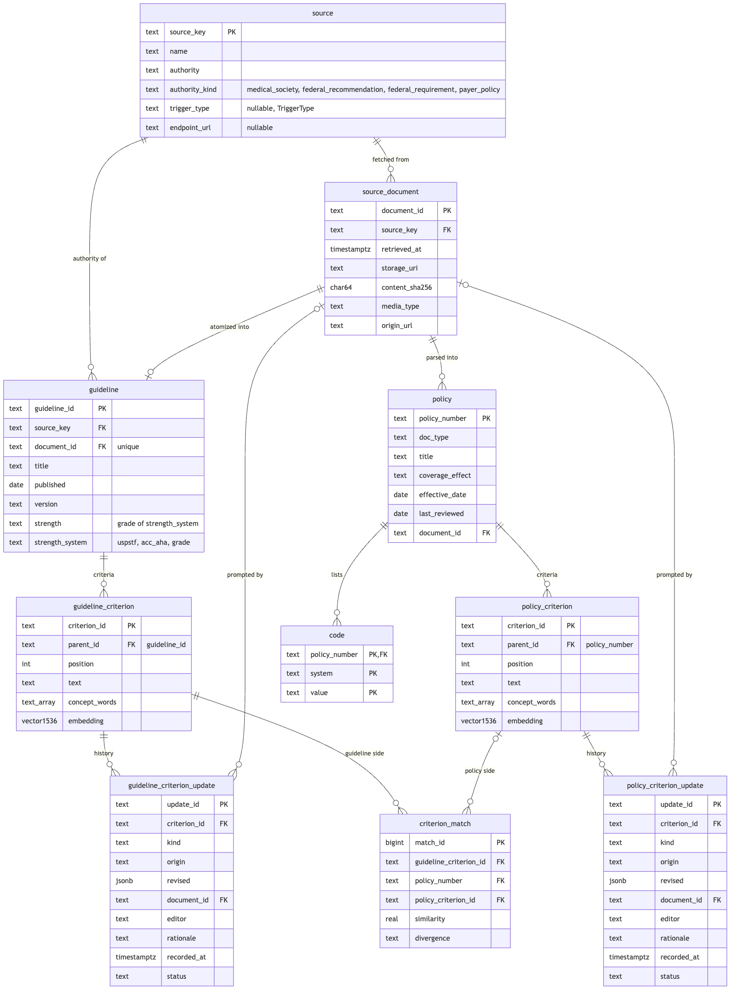

# Policy Radar — Backend Spec v0

Status: **implemented v0, not yet run against a database or the OpenAI API** (Postgres 15+ and pgvector ≥ 0.5 required; Supabase has both). Keep this file in step with the code: `db/schema.sql`,
`policy_radar/`. `tests/test_schema.py` fails if the SQL tables, the pydantic models and the
enums drift apart. The PDF (`docs/BACKEND_SPEC.pdf`) is rendered from this file — see
[Rendering](#rendering).

## Data model

Ten domain records, one table each, plus a `job` table for pipeline status. Pydantic
models are in `policy_radar/models.py`; the DDL is `db/schema.sql`. Column-level detail is
under [Tables](#tables).

::: diagram

:::

## Object storage

Local filesystem for now, rooted at `STORAGE_ROOT` (default `data/objects/`).

```
data/objects/
  {source_key}/
    {sha256}{ext}        e.g. openfda_drug_label/3f9c…e1.json, cpb_upload/a01b…77.pdf
```

`source_document.storage_uri` holds the key (`openfda_drug_label/3f9c…e1.json`), not a path, so the
same keys work unchanged in a Supabase Storage bucket. Keys are content-addressed, so
storing the same bytes twice writes once. Only `policy_radar/storage.py` knows where
objects live.

## Scope

This version covers only getting data in:

1. **Ingest guidelines** — fetch documents from the guideline sources (seven APIs and two web pages, each a row in `source`),
   and store each unchanged original as a `SourceDocument`.
2. **Atomize guidelines** — turn each stored guideline document into a `Guideline` with
   criteria, using OpenAI structured outputs, and embed each criterion.
3. **Parse CPBs** — accept uploaded Clinical Policy Bulletins, store them as
   `SourceDocument`s, and parse each into a `Policy` with criteria and codes.

**Not in scope:** matching a guideline change to policies. The tables
`guideline_criterion_update`, `policy_criterion_update` and `criterion_match` exist so the
data model matches the design diagram, but no code writes them yet. Expect the data model to change once matching is designed.

Stack: Python 3.12, FastAPI, Postgres + pgvector (Supabase later), asyncpg with plain SQL
(no ORM, no migrations tool), OpenAI API, local-filesystem object storage.

## Tables

### `source`

One row per endpoint or page we fetch from, seeded by `db/schema.sql` (re-applying the
schema updates the rows). Every key in `sources.SOURCES` plus `cpb_upload` has a row;
`tests/test_schema.py` fails if either side drifts.

| Column | Type | Key / constraint | Notes |
|---|---|---|---|
| source_key | text | **PK** | the key `GET /sources` returns |
| name | text | not null | |
| authority | text | not null | the body behind it |
| authority_kind | text | not null, check ∈ `AuthorityKind` | how urgently its changes matter, below |
| trigger_type | text | check ∈ `TriggerType` | which policies it can send back into review; null for uploads |
| endpoint_url | text | | null for uploads |

`authority_kind` answers urgency:

| Kind | Meaning | Sources |
|---|---|---|
| `medical_society` | proposes changes that may lead to a policy change; not urgent | `pubmed` (practice guidelines, mostly society-authored) |
| `federal_recommendation` | recommends; does not bind payers directly | `uspstf`, `cdc_acip_adult`, `cdc_acip_child` |
| `federal_requirement` | binding rules, coverage determinations and approvals; active changes are tracked | `federal_register`, `ecfr`, `cms_coverage`, `openfda_drug_label`, `openfda_device_510k` |
| `payer_policy` | the payer's own documents | `cpb_upload` |

Notes: USPSTF grade A and B recommendations become coverage requirements for most plans
under the ACA, so urgency can also depend on the grade; `authority_kind` is the
source-level default only. `pubmed` mixes many societies under one key until it is split by
journal or society. Whether a federal rule is proposed or final is a property of the
document, not the source, and is not modelled yet.

### `source_document`

An immutable fetched or uploaded file. One row per distinct set of bytes per source.

| Column | Type | Key / constraint | Notes |
|---|---|---|---|
| document_id | text | **PK** | `{source_key}-{sha256[:16]}` |
| source_key | text | **FK** → source, not null | a key from `GET /sources`, or `cpb_upload` |
| retrieved_at | timestamptz | not null | |
| storage_uri | text | not null | object key, see [Object storage](#object-storage) |
| content_sha256 | char(64) | not null | |
| media_type | text | not null | e.g. `application/pdf`. Not on the diagram; needed to read the file |
| origin_url | text | | where it was fetched from; null for uploads |
| | | **unique** (source_key, content_sha256) | a re-fetch of identical bytes is skipped |

### `guideline`

| Column | Type | Key / constraint | Notes |
|---|---|---|---|
| guideline_id | text | **PK** | random hex |
| source_key | text | **FK** → source, not null | |
| document_id | text | **FK** → source_document, **unique**, on delete cascade | one guideline per document |
| title | text | not null | |
| published | date | not null | falls back to the retrieval date if the document states none |
| version | text | | |
| strength | text | | a grade of `strength_system`, e.g. `B` |
| strength_system | text | check ∈ `StrengthSystem` | grades are never normalised across systems |

`strength` and `strength_system` are both set or both null, and the grade must belong to the
system. SQL enforces this with table checks, `Guideline` with a validator, and
`tests/test_schema.py` fails if the SQL and `STRENGTH_VALUES` drift. The extraction prompt
lists the allowed pairs; a mismatched pair fails that document, which the job records.

| `strength_system` | `strength` values | Scale | Not stored |
|---|---|---|---|
| `uspstf` | `A`, `B`, `C`, `D`, `I` | USPSTF letter grades (definitions since July 2012); `I` = insufficient evidence | |
| `acc_aha` | `1`, `2a`, `2b`, `3_no_benefit`, `3_harm` | ACC/AHA class of recommendation | level of evidence (A, B-R, B-NR, C-LD, C-EO), an independent axis |
| `grade` | `strong`, `conditional` | GRADE strength of recommendation | certainty of evidence (high to very low), an independent axis |

A document graded under any other scheme, or with no single overall grade, gets both
columns null; add the scheme to the enum when one is needed. A guideline with many
recommendations carries only its overall grade here.

### `policy`

| Column | Type | Key / constraint | Notes |
|---|---|---|---|
| policy_number | text | **PK** | e.g. `0584` |
| doc_type | text | not null, check ∈ `PolicyDocumentType` | |
| title | text | not null | |
| coverage_effect | text | not null, check ∈ `CoverageEffect` | the predominant determination |
| effective_date | date | not null | |
| last_reviewed | date | | |
| document_id | text | **FK** → source_document, not null | not on the diagram; the file it was parsed from |

`watched_triggers` is derived from `doc_type` in Python (`WATCHED_TRIGGERS` in
`models.py`) and not stored. It is a routing hint and must never exclude a policy.

### `guideline_criterion` and `policy_criterion`

Same columns, two tables, so each owner and each update history get a typed foreign key.

| Column | Type | Key / constraint | Notes |
|---|---|---|---|
| criterion_id | text | **PK** | `{parent_id}:{position}` |
| parent_id | text | **FK** → guideline (or policy), on delete cascade | `guideline_id` / `policy_number` |
| position | int | not null | order within the owner, from 1; not on the diagram |
| text | text | not null | |
| concept_words | text[] | not null, default `{}` | |
| embedding | vector(1536) | HNSW index, cosine | OpenAI `text-embedding-3-small`; not on the diagram |

`needs_update` is derived when criteria are read: true if a row in the matching
`*_criterion_update` table has status `pending`.

### `code`

| Column | Type | Key / constraint |
|---|---|---|
| policy_number | text | **PK** part, **FK** → policy, on delete cascade |
| system | text | **PK** part, check ∈ `CodeSystem` |
| value | text | **PK** part |

### `guideline_criterion_update` and `policy_criterion_update` (no writer yet)

| Column | Type | Key / constraint | Notes |
|---|---|---|---|
| update_id | text | **PK** | |
| criterion_id | text | **FK** → `guideline_criterion` / `policy_criterion`, on delete cascade | the history relation |
| kind | text | check ∈ `revise`, `retire` | |
| origin | text | check ∈ `guideline_change`, `manual` | |
| revised | jsonb | | the proposed `GuidelineCriterion` / `PolicyCriterion` when kind is `revise` |
| document_id | text | **FK** → source_document | the guideline document behind it |
| editor | text | | |
| rationale | text | not null | |
| recorded_at | timestamptz | not null | |
| status | text | check ∈ `pending`, `accepted`, `rejected`; default `pending` | |

### `criterion_match` (no writer yet)

| Column | Type | Key / constraint | Notes |
|---|---|---|---|
| match_id | bigint identity | **PK** | surrogate: `policy_criterion_id` may be null |
| guideline_criterion_id | text | **FK** → guideline_criterion | |
| policy_number | text | **FK** → policy | not on the diagram; with a null counterpart it is the only record of which policy had none |
| policy_criterion_id | text | **FK** → policy_criterion, null = no counterpart | |
| similarity | real | check 0–1 | |
| divergence | text | | |
| | | **unique nulls not distinct** (guideline_criterion_id, policy_number, policy_criterion_id) | needs Postgres 15 |

The diagram's `guideline_id` was dropped: it follows from the guideline criterion.

### `job`

| Column | Type | Notes |
|---|---|---|
| job_id | text **PK** | |
| kind | text | `ingest`, `atomize`, `parse_cpb` |
| status | text | `queued` → `running` → `succeeded` or `failed` |
| detail | jsonb | inputs, then result counts and per-document failures |
| error | text | set when the whole job fails |
| created_at, finished_at | timestamptz | |

### Known limits of this model

- Re-parsing a CPB with the same `policy_number` deletes and replaces the policy, its
  criteria and codes — and, by cascade, any `policy_criterion_update` history on those criteria.
  Policy versioning has to be decided together with matching.
- Re-atomizing a document replaces its guideline the same way.
- There is no version chain between two guidelines on the same topic; each fetch that
  changes the bytes is a new `SourceDocument` and a new `Guideline`.

## Guideline sources

All connectors are in `policy_radar/sources.py`, one function each. Each validates the
response with a per-provider pydantic model (`policy_radar/responses/`), then returns one
file per document, as the source served it. Response shapes, quirks and test status per
provider are in [INGESTION_SPEC.md](INGESTION_SPEC.md). Keys are per endpoint or page, and
each has a row in the [`source`](#source) table.
Runs are capped at 1,000 records per endpoint (`MAX_RECORDS_PER_ENDPOINT`); a capped
run logs a warning.

| Key | Source | What one document is | Change detection | Auth |
|---|---|---|---|---|
| `openfda_drug_label` | openFDA `drug/label` | one label version, JSON | `effective_time` ≥ since | `OPENFDA_API_KEY` optional |
| `openfda_device_510k` | openFDA `device/510k` | one 510(k), JSON | `decision_date` ≥ since | `OPENFDA_API_KEY` optional |
| `federal_register` | Federal Register v1 | one HHS/CMS/FDA rule or proposed rule, raw text | `publication_date` ≥ since | none |
| `ecfr` | eCFR versioner, titles 42 and 45 (all result pages) | one amended CFR section, XML | substantive versions with `amendment_date` ≥ since | none |
| `cms_coverage` | CMS Coverage API | one NCD, JSON | `last_updated_sort` ≥ since | none |
| `uspstf` | Prevention TaskForce API | one specific recommendation plus its topic, JSON | none in the API; content hash | `USPSTF_API_KEY` required |
| `pubmed` | NCBI E-utilities | one "practice guideline" article, XML | `mdat` ≥ since | `NCBI_API_KEY` optional |
| `cdc_acip_adult` | CDC ACIP adult immunization schedule page | one page, HTML | content hash | none |
| `cdc_acip_child` | CDC ACIP child and adolescent schedule page | one page, HTML | content hash | none |

Open points:

- **CMS LCDs are not ingested.** Their detail endpoint needs a token, and requesting the
  token accepts the AMA/ADA/AHA license terms. That is your call to make.
- **USPSTF is unverified against real content** (no key yet), so its response model
  requires only the field the connector reads. The key parameter is
  undocumented; the code sends `key=` and fails loudly on the API's HTTP 202 "no key"
  placeholder. See [INGESTION_SPEC.md](INGESTION_SPEC.md#uspstf--uspstfpy).
- **openFDA volume**: about 5,000 label versions a month, each an LLM call when atomized.
  The cap bounds this; filtering to relevant drugs needs a decision.
- Pages with no API get one function and one `source` row each (the two CDC ACIP
  schedules today). Add society pages the same way.

## Pipelines

All three run as FastAPI background tasks in the API process and report through the `job`
table. A job still running when the process stops stays `running`; that is acceptable for
v0. A failure on one document is recorded in the job's `detail.failed` and the run
continues.

**Ingest** (`POST /guidelines/ingest/{source_key}?since=YYYY-MM-DD`): call the source's
connector for everything published since `since` (default: the source's last new
document, or 30 days back on first run) → for each file, write it to object storage and
insert a `source_document` row unless the same bytes are already stored. Result:
`{since, fetched, new}`.

**Atomize** (`POST /guidelines/atomize`): for every guideline-source document with no
`guideline` row → send the document to OpenAI (PDF as a file, HTML reduced to text,
JSON/XML as text) with a fixed instruction and the `ExtractedGuideline` schema → assign
`guideline_id` and criterion ids → embed each criterion's text → write `guideline` and
`criterion` rows in one transaction. Result: `{processed, failed}`.

**Parse CPBs** (`POST /policies/ingest`, or `POST /policies/documents` then `POST /policies/parse`):
uploads (PDF, DOCX, HTML, plain text or Markdown) are stored as `source_document` rows with
`source_key = cpb_upload`. The file's bytes decide its format, not the declared type or filename
(`policy_radar/parsing.py`); unsupported formats are refused with 415 and files over 25 MB with 413.
PDFs go to the model as native files; other formats are converted to text first (DOCX tables become
one `|`-separated line per row). Parsing does the same as atomize with the `ExtractedPolicy` schema
and writes `policy`, `criterion` and `code` rows, up to 4 documents at a time. `/policies/ingest`
stores the files and parses the new ones in one job; a file whose bytes are already stored is
reported as a duplicate and not parsed again (retry failures with `/policies/parse`).
Result: `{stored, duplicates, processed, failed}` for ingest, `{processed, failed}` for parse.

Prompts and extraction schemas are in `policy_radar/llm.py`.

## API

| Method | Path | Does |
|---|---|---|
| GET | `/health` | liveness |
| GET | `/sources` | ingestible sources: key, name, authority, authority kind, trigger type, endpoint |
| POST | `/guidelines/ingest/{source_key}` | start an ingest job → `{job_id}` |
| POST | `/guidelines/atomize` | start an atomize job → `{job_id}` |
| GET | `/guidelines` | list guidelines |
| GET | `/guidelines/{guideline_id}` | one guideline with criteria |
| POST | `/policies/documents` | upload CPB files (multipart `files`) → `{stored, duplicates}` |
| POST | `/policies/ingest` | upload CPB files and parse them in one background job → `{job_id}` |
| POST | `/policies/parse` | start a CPB parse job → `{job_id}` |
| GET | `/policies` | list policies |
| GET | `/policies/{policy_number}` | one policy with criteria, codes, watched triggers |
| GET | `/jobs/{job_id}` | job status and result |

No authentication yet.

A placeholder route (`POST ""`, "ingest all guidelines") exists in `api.py` with no body; it is not part of the API yet.

## Configuration

Every setting comes from `.env`; `example.env` lists them. `DATABASE_URL` and
`OPENAI_API_KEY` are required and the app does not start without them.

## Code layout

```
frontend/                  Vite + React review UI (separate from the backend; see FRONTEND_SPEC.md)
db/schema.sql              tables, keys, indexes
scripts/create_schema.py   applies schema.sql to DATABASE_URL
policy_radar/
  enums.py                 controlled vocabularies (mirrored by schema checks)
  models.py                domain models (one per table)
  config.py                settings from .env
  storage.py               object storage
  db.py                    all SQL
  sources.py               one fetch function per guideline source
  llm.py                   OpenAI extraction and embeddings
  pipelines.py             ingest, atomize, parse
  api.py                   FastAPI routes
notebooks/                 exploratory work, not imported by the app: intervention normalizer
                           (see [INTERVENTION_NORMALIZATION.md](INTERVENTION_NORMALIZATION.md)) and RAG comparison
tests/
```

## Rendering

```bash
cd docs && pandoc BACKEND_SPEC.md -o BACKEND_SPEC.pdf --pdf-engine=weasyprint --css pdf.css
```
